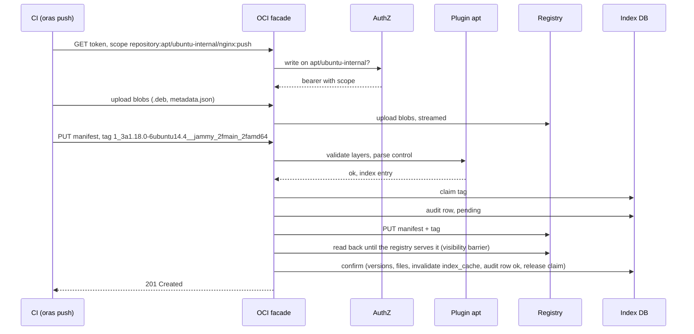
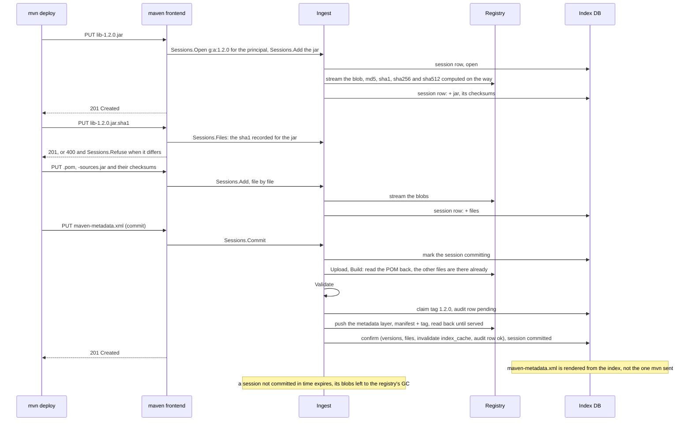
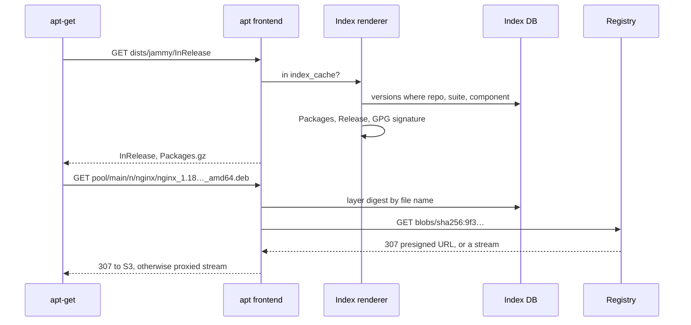
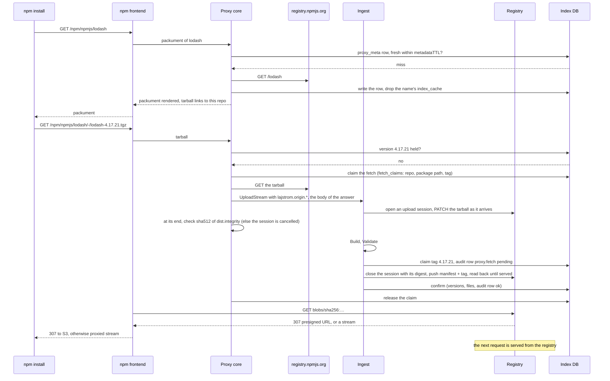
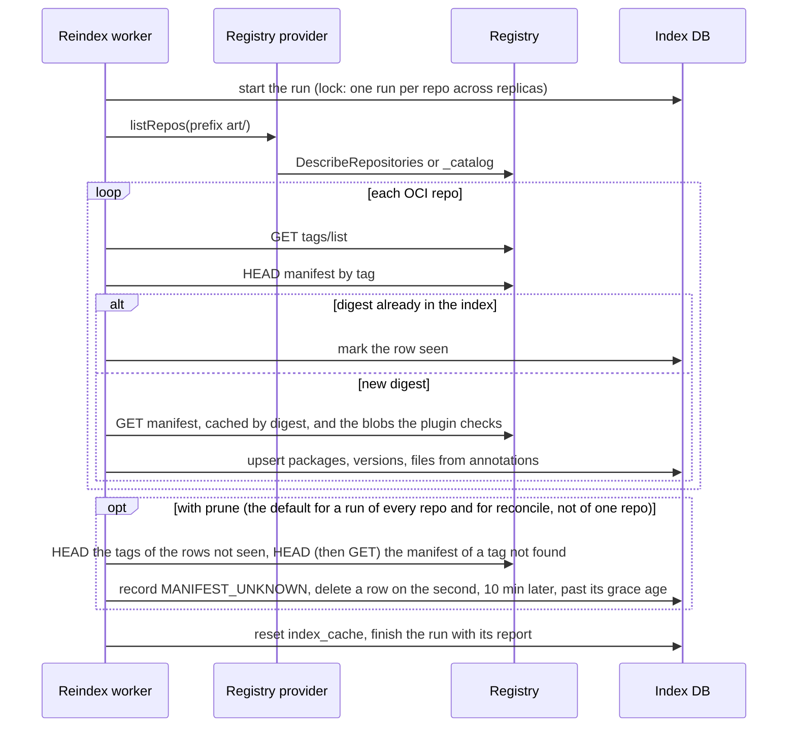
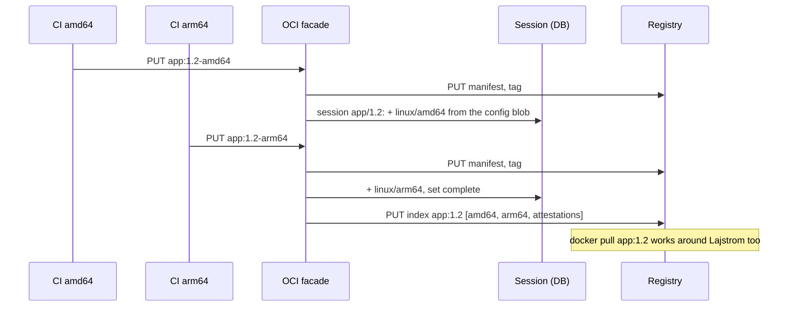

# Lajstrom architecture

- Status: draft, 2026-11-06 (translated from the Russian design page of 2026-11-05)
- Owner: @gecube
- Normative details live in [`docs/spec/`](spec/); decisions in [`docs/adr/`](adr/). When this
  document and a spec disagree, the spec wins. When a spec and an accepted ADR disagree, open an issue.

Lajstrom is an artifact registry on top of any OCI registry. *Lajstrom* is Hungarian for
"register, inventory": we keep the inventory, the warehouse belongs to someone else. apt, rpm,
maven, pypi, npm, terraform and raw files for ordinary clients. The bytes live only in the backend
registry: ECR, docker distribution, Harbor, Zot, GHCR. We own the protocols, the index and the
permissions, and not a single blob.

## Invariants

1. **The registry is the source of truth.** The tag and the manifest annotations are enough to
   rebuild the index.
2. **The database is derived.** Postgres or SQLite; the `reindex` command restores it from the
   registry. A small control plane (repos, users, tokens, bindings, audit) is the exception: it is
   not derivable, it is small, and it is backed up.
3. **One write path.** `oras push`, `mvn deploy` and `twine upload` converge on one ingest
   pipeline through a format plugin. Referrers (`cosign sign`, `oras attach`) go through the
   same pipeline, which checks, locks, pushes and audits them and indexes nothing (#28).
4. **One endpoint.** `https://host/<format>/<repo>/`; the OCI name mirrors the path:
   `host/<format>/<repo>/<pkg>`.
5. **No client plugins.** Protocols are emulated on the server; native OCI clients (helm, oras,
   tofu, cosign, flux) go through the OCI facade.

## 1. Components and ownership

```mermaid
flowchart TB
  subgraph clients["Clients"]
    direction LR
    proto["Protocol clients, no plugins<br/>apt · dnf · mvn/gradle · pip/twine · npm · terraform · curl"]
    native["OCI-native clients<br/>helm · oras · tofu · cosign · flux"]
    ui["lajstrom-ui* (separate repo, static bundle, any origin) · CLI · CI jobs"]
  end

  router["Edge router · https://host · one endpoint, optionally repo.host*<br/>/&lt;format&gt;/&lt;repo&gt;/… → frontends · /v2/… → OCI facade · /.well-known/terraform.json* · /api/v1"]

  subgraph front["Protocol frontends (read-mostly emulation)"]
    direction LR
    fe["apt · rpm* · maven · pypi · npm · tf* · go* · cargo* · nuget* · raw<br/>GET: index from cache, file by digest from the registry<br/>PUT (mvn deploy, twine, curl -T): the same ingest as oras push"]
  end
  facade["OCI facade · /v2/<br/>token endpoint: bearer with scopes from RBAC<br/>manifest/blob: proxy to the backend registry<br/>PUT manifest → hook → format plugin<br/>blob GET → 307 to the registry's presigned URL"]
  api["API<br/>/api/v1 REST · SSO* · audit"]

  subgraph core["Core: protocols, meaning of bytes, permissions"]
    direction LR
    repomgr["Repo manager<br/>hosted · proxy · group<br/>format, backing registry, prefix"]
    auth["AuthN / AuthZ<br/>OIDC*, local users, groups from claims*<br/>tokens: PAT with expiry, deploy tokens per repo or repo mask<br/>RBAC: binding = role × repo mask"]
    ingest["Ingest pipeline<br/>validate → claim the tag → push → read back → index<br/>publication sessions (maven)<br/>dedup by digest, 409 on tag collision"]
    render["Index renderer<br/>Packages, Release · repodata<br/>maven-metadata · simple · packument<br/>cache + signing with the repo's GPG key"]
    proxy["Proxy fetcher, npm only<br/>miss → claim → upstream → stream, check → ingest<br/>TTL metadata cache in the DB"]
    reindex["Reindex / reconcile<br/>listRepos → tags/list → manifests<br/>upsert from annotations, remove orphans<br/>catches writes that bypassed us"]
    retention["Delete<br/>a version through the API, audited<br/>retention: an external scheduler runs<br/>lajstrom admin retention<br/>blob GC is the registry's job"]
    keys["Keys · audit · events<br/>GPG key per repo, later KMS<br/>cosign signatures and SBOM via referrers<br/>audit log · webhooks*"]
    plugins["Format plugins, in-process Go<br/>apt · rpm* · maven · pypi · npm · tf* · go* · cargo* · nuget* · raw<br/>interface: Name · ArtifactType · EscapeName · Validate · Build · Routes · RenderIndex<br/>oci repos: pass-through in the facade, no plugin, no index"]
  end

  upstream["Upstream (external)<br/>npmjs · Maven Central* · PyPI* · deb/rpm mirrors* · registry.terraform.io*"]
  db[("Index DB · Postgres / SQLite<br/>derived, rebuilt by reindex: packages · versions · files · index_cache · oci_repos · journal · journal_state<br/>control plane, small, backed up: repos · users · tokens · bindings · audit")]
  provider["Registry provider · oras-go + per-registry adapter<br/>data path: OCI distribution spec, shared by all registries<br/>lifecycle: ensureRepo · listRepos · deleteRepo · creds · capabilities<br/>adapters: ECR · distribution · Harbor · Zot · GHCR<br/>capabilities: referrers, catalog, delete, immutable tags, blob redirect"]
  registry[("Any OCI registry · truth for content<br/>blobs · manifests · tags · referrers · content-addressed, dedup<br/>GC · replication · HA · encryption · IAM are the registry's concern<br/>blob 307 → the client downloads from S3/CDN directly")]

  proto -->|"GET index and files · PUT: mvn deploy, twine"| router
  native -->|"push / pull · bearer"| router
  ui -->|"REST · SSO*"| router
  router --> front
  router --> facade
  router --> api
  front -->|"read: index cache + DB · write: ingest"| core
  facade -->|"authz · proxy · ingest hook"| core
  api --> core
  core -.->|"cache miss → fetch"| upstream
  core -->|"index read/write · control plane"| db
  core -->|"push blobs, manifests · tag · delete"| provider
  provider -->|"OCI distribution API · HTTPS"| registry
```

`*` = after the MVP (dashed in the original diagram).

One endpoint. Frontends read from the derived index and serve files by digest; all writes converge
on one ingest through a format plugin. Bytes exist only in the backend registry, and only one
component talks to it: the registry provider.

## 2. What lives where: product model, registry, database

| Product model | In the registry (source of truth) | In the index DB (filled by ingest and reindex) |
| --- | --- | --- |
| **Repo** `apt/ubuntu-internal` · hosted · backing `ecr-prod` · prefix `art/` · anonymous read | **OCI repository** `art/apt/ubuntu-internal/nginx` (lowercase) | `repos` (control plane): format · name · registry · prefix · kind · policy |
| **Package** `nginx` · name as the format spells it, original case kept in an annotation | | `packages`: repo_id · name · name_oci |
| **Version** `1:1.18.0-6ubuntu14.4` · `amd64` · suite `jammy` · component `main` (upload metadata, not a separate repo; the variant is `jammy/main/amd64`) | **Tag** `1_3a1.18.0-6ubuntu14.4__jammy_2fmain_2famd64` (`Escape(version)__Escape(variant)`; every byte outside `[A-Za-z0-9.-]` becomes `_xx` hex: `:`→`_3a`, `+`→`_2b`, `~`→`_7e`, `_`→`_5f`, `/`→`_2f`) | `versions`: package_id · version · variant · tag · digest · artifact_type · attrs (arch, suite, component) · metadata · created_at |
| | **Manifest** (OCI image manifest 1.1): `artifactType application/vnd.lajstrom.deb.v1`; annotations `format=apt`, `repo=ubuntu-internal`, `name=nginx`, `version=1:1.18.0-6ubuntu14.4`, `arch=amd64`, `suite=jammy`, `component=main`; `layers[0] vnd.lajstrom.deb.package.v1`, `layers[1] vnd.lajstrom.deb.metadata.v1+json`; `config application/vnd.oci.empty.v1+json` | `index_cache`: repo_id · scope · kind · content · sha256 · rendered_at · signed_at |
| **Files** `nginx_1.18.0-6ubuntu14.4_amd64.deb` 1.2 MiB, `metadata.json` (control, md5sums); file size limit: the repo's `policy.maxFileSize` (a default per format), capped by the registry's `maxBlobSize` | **Referrers** (subject = this manifest): cosign signature · SBOM · SLSA attestation, the same for every format. **Blobs**: content-addressed, deduplicated across repos and formats | `files`: version_id · name · media_type · digest · size · attrs |

Invariant: every row of `packages`, `versions`, `files` and `index_cache` can be recovered from the
tag and the manifest annotations. Annotations carry only search keys, prefixed `lajstrom.`. Large
metadata (control, POM, package.json) lives in the metadata layer. The control plane (repos, users,
bindings) is not derived: it is small and backed up; after the MVP it may also be snapshotted
into the registry as `<prefix>_meta/config`.

The tag is a lookup key, not the truth. The truth is in the manifest annotations, so reindex does
not depend on the escaping scheme and survives repository renames. A tag collision on ingest
returns 409, never an overwrite.

The normative version of this section is [`spec/manifest-profile.md`](spec/manifest-profile.md)
and [`spec/index-schema.md`](spec/index-schema.md).

## 3. Flows

Five scenarios carry the design. Other protocols differ only in how the index is rendered.

### A. Publish with `oras push`

One write path. The hook on `PUT manifest` turns the facade into a full upload API for deb and
rpm, which have no upload protocol of their own.

A signature or an SBOM of the version (a manifest with `subject`, or cosign's legacy
`sha256-<hex>.sig`) takes the same `PUT manifest` into the pipeline's referrer path instead:
the subject and the blobs are checked, the manifest is pushed as it came (under the referrers
lock of the subject, the tag lock a delete of the version holds, where the subject is checked
again; without a referrers API the push also rewrites the `sha256-<hex>` index under it), an
audit event is written, and no derived row: the referrers are listed from the registry
(manifest-profile.md §6).

### B. Publish with `mvn deploy`

Maven uploads files one by one, while in OCI a version is one manifest. A publication session of
ingest (`format.Sessions`, a row of the index per `g:a:v`) gathers the files: each one streams
into the registry as it arrives and is recorded with its checksums; nothing is published before
the commit, the `PUT maven-metadata.xml`, which hands the files to ingest's upload, as any other
publish.

### C. Read: `apt-get update` and `install`

The index is signed with our per-repo GPG key and served from the cache. The `.deb` itself can be
fetched by the client straight from the registry's S3 via a 307.

### D. Proxy repo: npm cache miss

A proxy repo serves an upstream and keeps what it fetched. A file it does not hold is fetched
once across replicas, streamed into the registry through ingest like an upload and checked
against the upstream's checksum before it is committed; the client then gets it from the
registry, and the next request for it does not touch the upstream. The upstream's documents are
cached in the DB (`proxy_meta`) with a TTL. npm is the only format with a proxy so far; pypi has
none yet ([proxy-and-group.md](spec/proxy-and-group.md) §4 and §5).

Concurrent misses of one artifact share its fetch: on one replica in memory, across replicas
through the claim, while the others look the version up in the index until it appears. The fetch
runs on a context of its own, so a client that leaves does not cancel it for the requests that
wait on it. A file that fails its checksum or its size bound, or that Validate refuses, is never
published: it is a `proxy.reject` audit row (proxy-and-group.md §6).

### E. Reindex

The proof that the DB is derived. Runs on recovery, when an existing prefix is attached, and on a
schedule as reconcile.

Reindex marks and sweeps instead of emptying the tables first, so the frontends keep serving
during a run, and it reads a manifest only when its digest is new: a digest names the same
bytes, which were checked when they were written. A tag that names another digest than the index
is reported as drift and never re-pointed (index-schema.md, Invariants). The worker writes
nothing to the registry itself: on a registry without the referrers API, a reconcile run or one
with `--verify` asks ingest, the one write path, to push again a subject's `sha256-<hex>` index
that lacks referrers the audit log has as pushed (#628).

## 4. Boundaries of responsibility

| Zone | What is inside | What it buys |
| --- | --- | --- |
| Backend registry | blobs, manifests, tags, referrers; GC, replication, HA, encryption, IAM, quotas, size limits | No filestore, no clustering, no content backups of our own. Cross-region replication is ECR configuration, not our feature. |
| Our code | router, protocol frontends, OCI facade, ingest, index rendering and signing, RBAC and tokens, proxy and group, delete (retention is a client of it, #72), audit, registry provider; the UI is a separate repo, lajstrom-ui | Everything about the meaning of bytes and about permissions. One Go binary plus a database. |
| Index DB | derived: packages, versions, files, index_cache, proxy metadata. Control plane: repos, users, tokens, bindings, sessions, audit | The derived part can be lost and rebuilt. The control plane is small and backed up; a snapshot into the registry comes after the MVP. |
| Clients | apt, dnf, mvn, pip, npm, terraform, curl without plugins; helm, oras, tofu, cosign, flux through the facade | Nothing to install on clients. One `user:token` pair works across all protocols. |

## 5. Registry capabilities

The data path is shared; registries differ in lifecycle and in OCI 1.1 support. What each
registry does is measured, not remembered, and kept in one place:
[registries/README.md](registries/README.md), the matrix. It holds the versions tested and their
support tier (`CI`, `manual`, `hosted`, `untested`), one row per capability and one column per
registry, the object stores behind distribution, the places where a registry deviates from the
distribution and image specs (the list for upstream), and the configuration each registry
needs. The provider's probe and its vendor table
([configuration.md](configuration.md#registry-capabilities)) are checked against it, and an
operator reads it to know whether a backend is supported and how. Whoever changes a pinned
registry version re-measures and updates it; the rule is on that page.

Two rules keep a registry without an optional API usable:

- Without a referrers API: the `sha256-<digest>` tag schema, as cosign does (distribution
  3.1.2, the GitLab container registry, GHCR).
- Without a catalog: keep the list of repos in the DB and reconcile through the adapter (Harbor
  for a project robot; GHCR, whose catalog is all of GHCR).

The phase-0 table this section carried is resolved there. Its two *verify* cells are measured:
Harbor v2.15.4 serves the OCI 1.1 referrers API, and GHCR has none (404 `MANIFEST_UNKNOWN`). Its
ECR row was written from memory and is in the matrix's `untested` tier as it was, marked so:
the spike (#19) needs an AWS account and has not run.

## 6. Manifest types: what the ecosystem already has, and our profile

Rule in one line: where an ecosystem has its own OCI convention we do not reinvent it; we pass it
through a repo of type `oci` and only recognise it for the UI. We define our own types where no
convention exists: deb, rpm, maven, pypi, npm, nuget, cargo, go, raw. *Italic* = from memory,
verify against the sources before relying on it.

| Ecosystem | Identification: artifactType or config | Layers | Versions, platforms, tags | Source |
| --- | --- | --- | --- | --- |
| OCI image (reference) | manifest `application/vnd.oci.image.manifest.v1+json`, config `application/vnd.oci.image.config.v1+json` | `application/vnd.oci.image.layer.v1.tar+gzip` | image index with `platform` for multi-arch | OCI image-spec |
| OCI 1.1 artifact guidance | `artifactType` on the manifest, config `application/vnd.oci.empty.v1+json` | any; the type describes the bytes | `subject` + referrers API, fallback tag `sha256-<digest>` | OCI image-spec 1.1 |
| ORAS generic | `--artifact-type`; config `--config file:type` or empty | `file:mediatype`, file name in `org.opencontainers.image.title` | arbitrary tag; `oras pull` restores files by title | oras.land |
| Helm | config `application/vnd.cncf.helm.config.v1+json` | `application/vnd.cncf.helm.chart.content.v1.tar+gzip`, `…provenance.v1.prov` | tag = chart version, strictly; *`+` → `_` from memory* | helm.sh |
| OpenTofu provider | index `artifactType application/vnd.opentofu.provider`, per-platform manifest `application/vnd.opentofu.provider-target` | exactly one `archive/zip` | image index with os/arch; tag = semver, `+` → `_` | opentofu.org |
| OpenTofu module | `artifactType application/vnd.opentofu.modulepkg` | exactly one `archive/zip` | version via `?tag=` or `?digest=`, default `latest` | opentofu.org |
| Flux | config `application/vnd.cncf.flux.config.v1+json` | `application/vnd.cncf.flux.content.v1.tar+gzip` | `org.opencontainers.image.source|revision|created`; cosign or notation | fluxcd.io |
| Timoni | config `application/vnd.timoni.config.v1+json` | `application/vnd.timoni.content.v1.tar+gzip` | tag = X.Y.Z, `latest` mutable; `sh.timoni.images` | timoni.sh |
| CUE modules | `artifactType application/vnd.cue.module.v1+json` | `application/zip` + `application/vnd.cue.modulefile.v1` | repo = prefix/modulePath; second layer gives dependencies without unpacking | cuelang.org |
| Wasm (CNCF) | config `application/vnd.wasm.config.v0+json` | exactly one `application/wasm` | platform arch `wasm`, os `wasip1|wasip2` | tag-runtime.cncf.io |
| ModelPack (CNCF) | `artifactType application/vnd.cncf.model.manifest.v1+json`, config `application/vnd.cncf.model.config.v1+json` | `application/vnd.cncf.model.{weight,weight.config,doc,code,dataset}.v1.{raw,tar,tar+gzip,tar+zstd}` | weights uncompressed; roles in the layer type | modelpack/model-spec |
| cosign | manifest with config `application/vnd.oci.image.config.v1+json` | `application/vnd.dev.cosign.simplesigning.v1+json`; annotations `dev.cosignproject.cosign/signature|certificate|chain` | tag `sha256-<digest>.sig`; *`.att`, `.sbom`, bundle `application/vnd.dev.sigstore.bundle.v0.3+json` via referrers: from memory* | sigstore specs |
| Notation | `artifactType application/vnd.cncf.notary.signature`, config `application/vnd.oci.empty.v1+json` | `application/jose+json` or `application/cose` | `subject` + referrers; annotation `io.cncf.notary.x509chain.thumbprint#S256` | notaryproject |
| SBOM and attestations | *referrers payload* | *`application/spdx+json`, `application/vnd.cyclonedx+json`, `application/vnd.in-toto+json`, DSSE `application/vnd.dsse.envelope.v1+json`* | *from memory* | *verify* |
| conda-oci-mirror | no artifactType | `application/vnd.conda.package.v2` (.conda), `.v1` (.tar.bz2), `application/vnd.conda.info.v1.tar+gzip`, `application/vnd.conda.info.index.v1+json`; annotation `org.conda.md5` | repo `<channel>/<subdir>/<name>`, tag `<version>-<build>`; `+`→`__p__`, `!`→`__e__`, `=`→`__eq__`; names with `_` get prefix `zzz`; repodata at `…/repodata.json:latest` | channel-mirrors |
| pyoci | no artifactType, blobs `application/octet-stream` | one manifest per distribution file | tag = version → image index, platform os `any`, architecture encodes the wheel tag; annotations from classifiers | AllexVeldman/pyoci |
| apt-transport-oci | no artifactType | every file of the repo tree as a separate `application/octet-stream` layer, path in `org.opencontainers.image.title` | the whole repo snapshot as one artifact, tag in sources (`latest`) | AkihiroSuda/apt-transport-oci |
| maven-oci-registry (Seqera) | undocumented | undocumented | repo `<ns>/<groupId lowercase, . → ->/<artifactId>`, tag = version; proxy mode serves plain Gradle | seqeralabs |
| Homebrew bottles | *plain image manifest and index* | *`application/vnd.oci.image.layer.v1.tar+gzip`* | *annotations `sh.brew.bottle.*`, `org.opencontainers.image.ref.name` = version* | *from memory* |
| Docker Compose | *`artifactType application/vnd.docker.compose.project`* | *`application/vnd.docker.compose.file+yaml`, one layer per file* | annotations `com.docker.compose.version`, `com.docker.compose.extends` | docker/compose publish.go |
| Zarf, Trivy DB, Falco | *`application/vnd.zarf.config.v1+json`, `application/vnd.aquasec.trivy.config.v1+json`, `application/vnd.cncf.falco.rulesfile.config.v1+json`* | *`application/vnd.zarf.layer.v1.blob`, `…trivy.db.layer.v1.tar+gzip`, `…falco.rulesfile.layer.v1+tar.gz`* | *role in the layer type, like Helm* | *from memory* |

What follows from this. Three stable patterns: the role of a file is encoded in the layer
mediaType (Helm, conda, ModelPack, Falco); the file name lives in `org.opencontainers.image.title`
(ORAS, apt-transport-oci); platforms are either an image index with `platform` (OpenTofu, pyoci,
Wasm) or a separate tag per variant (conda). An image index per version is mutable: adding arm64
later means overwriting the tag. So we take the third option: one immutable tag per variant.

### Our profile (summary; normative text in [`spec/manifest-profile.md`](spec/manifest-profile.md))

| Element | Value | Why |
| --- | --- | --- |
| artifactType | `application/vnd.lajstrom.<format>.v1`, e.g. `application/vnd.lajstrom.deb.v1` | one key for "what package is this": selects the plugin, filters referrers |
| config | `application/vnd.oci.empty.v1+json` | as OCI 1.1 prescribes; no logic in config, everything in annotations and the metadata layer |
| file layer | `application/vnd.lajstrom.<format>.<role>.v1[+suffix]`: `…deb.package.v1`, `…rpm.package.v1`, `…maven.artifact.v1` (with `extension` and `classifier` annotations), `…maven.pom.v1+xml`, `…pypi.wheel.v1+zip`, `…pypi.sdist.v1.tar+gzip`, `…npm.tarball.v1.tar+gzip`, `…raw.file.v1` | role in the type, like Helm and conda: UI and policies filter by type without parsing file names |
| metadata layer | `application/vnd.lajstrom.<format>.metadata.v1+json`: control, POM, package.json, METADATA | UI, search and reindex read it without unpacking the package; like the second layer of CUE and the info layer of conda |
| manifest annotations | `lajstrom.schema=1`, `lajstrom.format`, `lajstrom.repo`, `lajstrom.name`, `lajstrom.version`, `lajstrom.variant`, format-specific keys such as `lajstrom.deb.arch|suite|component`, plus `org.opencontainers.image.created|source|revision` | enough for reindex without the metadata layer; standard keys are understood by other UIs |
| layer annotation | `org.opencontainers.image.title` = file name | `oras pull` without our software writes the original file to disk; exactly what apt-transport-oci requires |
| tag | `Escape(version)[__Escape(variant)]`; variant = the format's platform discriminator: suite/component/arch for deb, arch for rpm, the build tag (if any) and tag set of a wheel or `sdist` for pypi, none for maven, npm, tf. Escape: bytes outside `[A-Za-z0-9.-]` become `_xx` (`:`→`_3a`, `+`→`_2b`, `~`→`_7e`, `_`→`_5f`); the 2026-11-05 draft's `_`→`__` was dropped because it made the separator ambiguous (ADR 0005) | tags are immutable and append-only: a new architecture is a new tag, not an overwritten index. Compatible with ECR immutability |
| referrers | cosign, notation, SBOM, SLSA as they are, `subject` = our manifest | nothing of our own for the supply chain |
| passthrough | helm, opentofu, flux, timoni, cue, wasm, modelpack and unknown artifactTypes through a repo of type `oci` | recognised for the UI by the table above; bytes untouched |
| bit-compatibility | conda: as conda-oci-mirror; apt: snapshot export in the apt-transport-oci layout | pixi and apt-with-plugin can read us directly, without our server |

## 7. Docker passthrough and server-side multi-arch stitching (after the MVP)

The facade already proxies `/v2/`, so `docker push` and `docker pull` through Lajstrom work
without storing anything: RBAC and audit are ours, bytes are in the backend, blob GET is a 307 to
S3. On top of that Lajstrom can do what a third CI job does today with
`buildx imagetools create`: amd64 and arm64 images are pushed separately from native runners, and
Lajstrom assembles the shared index.

| Question | A. Virtual index on read | B. Materialise on hook (default) |
| --- | --- | --- |
| Mechanics | `GET app:1.2`, no such tag in the backend. The facade finds `app:1.2-amd64` and `app:1.2-arm64`, builds an OCI index on the fly and serves it | `PUT app:1.2-arm64` goes through the hook. A session (repo, image, 1.2) collects platforms. When the set is complete, Lajstrom pushes the index as `app:1.2` to the backend |
| Where the truth is | the index exists only with us: digest and contents in the DB | the index lives in the backend, as after `buildx imagetools create` |
| pull by digest | only through us, via the DB mapping | works everywhere, including around Lajstrom |
| cosign, referrers, replication, air-gap | the subject is absent in the backend, a signature dangles | standard: the index is a real object |
| Mutability | no write, no problem | the tag is written once, when the platform set is complete. A late arch: new version or alert, by repo policy |
| When to use | backend is read-only or foreign, writes not allowed | our normal case |

Details on which this breaks, in decreasing importance:

- **RBAC on top of a dumb backend.** docker distribution has no per-repo permissions, only htpasswd
  or an external token issuer. Clients talk only to the facade; the backend is closed by the
  network or trusts our issuer via `auth.token` with our certificate. The facade issues a standard
  docker bearer with scopes from our bindings, writes an audit record for every pull and push, and
  adds the immutability the backend lacks. What SUSE Portus did, as part of a larger
  product.
- **Platform from the config blob**, not from the tag suffix: `os`, `architecture`, `variant`.
  Suffixes `-{arch}`, `-{os}-{arch}`, `-{arch}{variant}` are configured per repo and only serve to
  find siblings.
- **Expected platform set** is configured on the repo (`platforms: linux/amd64, linux/arm64`) or
  as a push annotation `lajstrom.platforms`. Session timeout: assemble from what is there, or do
  not assemble, by policy.
- **buildx with provenance pushes an index**, not a manifest, with `unknown/unknown` entries.
  Stitching flattens it: takes manifests from each child index; the attestation follows its arch
  via the `vnd.docker.reference.digest` annotation.
- **Canonical JSON:** manifests sorted by platform, deterministic serialisation, the same digest
  on re-assembly.
- **Index type:** OCI image index. Docker manifest list v2 only in a compatibility mode, if all
  children are schema2.
- **Per-arch tags** stay visible or are hidden by policy. The index carries `lajstrom.stitched=true`
  and the list of source digests.
- **Pull-through cache for Docker Hub:** a repo of type `oci` with an upstream, the same proxy
  fetcher. Removes the rate limit; nothing separate is needed.

## Reference implementations worth reading (not copying)

- Gitea `routers/api/packages` and `modules/packages`: the best collection of protocol frontends
  and package parsers in Go (MIT). Read for protocol details; do not copy code (see the snippet
  scan in CONTRIBUTING.md).
- `oras-go` v2: the registry client we build the provider on.
- `distribution/distribution`: the reference registry; its `registry/api/v2` routes define what
  the facade must emulate; its token auth describes the bearer flow.
- pyoci, apt-transport-oci, conda-oci-mirror: existing format-over-OCI conventions, listed above.
